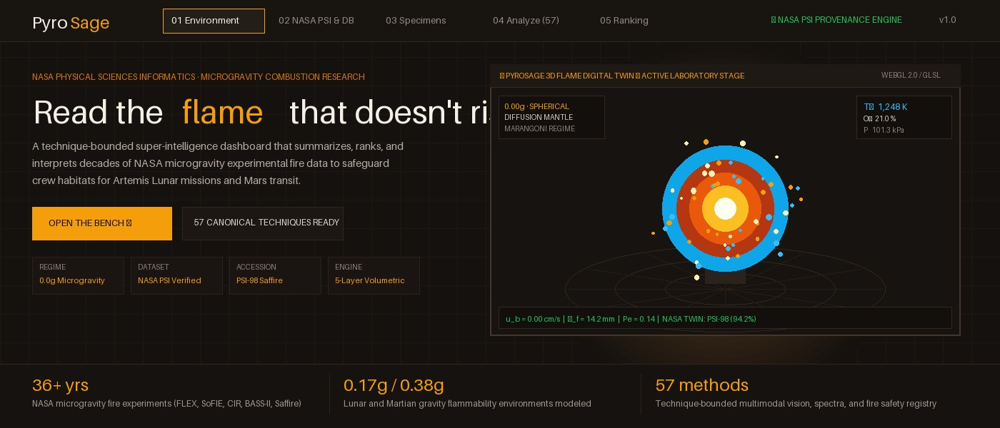
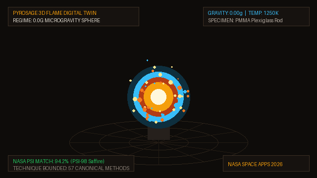
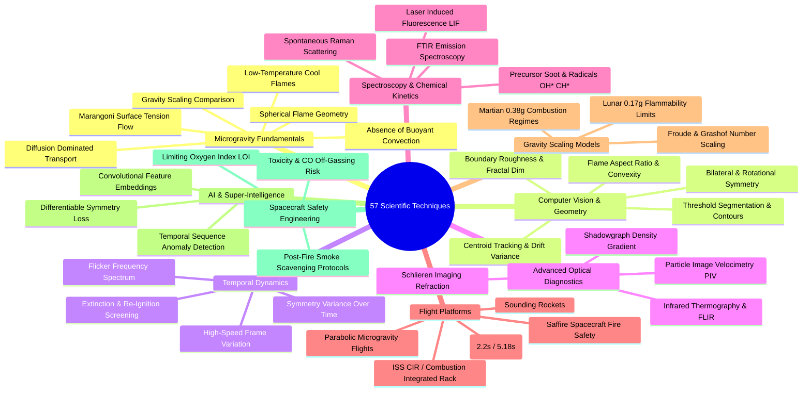
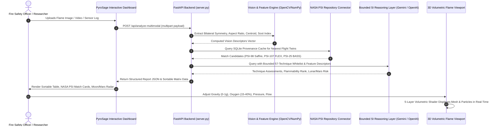

<div align="center">



# 🔥 PyroSage
### Super-Intelligence (SI) Powered Microgravity Fire Intelligence & Space Safety Dashboard

**Accelerating Fire Safety for NASA Artemis Lunar Missions & Mars Transit via Technique-Bounded Reasoning, Multimodal Evidence Mining, and 3D Volumetric Digital Twins.**

[](https://python.org/)
[](https://fastapi.tiangolo.com/)
[](https://threejs.org/)
[](https://opencv.org/)
[](https://psi.nasa.gov/physci/repo)
[](#-canonical-scientific-techniques-registry)
[](#-automated-testing--validation)

*“Read the flame that doesn't rise.”*

**[🚀 Interactive Dashboard](http://127.0.0.1:8000) · [📄 Technical Documentation (PDF)](PyroSage_Technical_Documentation.pdf) · [🛰️ NASA PSI Connector Notes](docs/NASA_PSI_CONNECTOR.md)**

</div>

---

## 🎥 3D Volumetric Flame Simulation (Live Engine Demo)

<div align="center">



*Figure 1: Real-time physics morphing between isotropic spherical $0g$ microgravity diffusion flames, hypoxic pale-cyan cool flames, and turbulent $1g$ terrestrial buoyant plumes with multi-species particle shedding (sparks, soot agglomerates, and radical ions).*

</div>

---

## 🌌 Problem Statement: NASA Space Fire Safety

> *“For decades, NASA has studied how flames and fire behave in microgravity, gathering a trove of experimental data along the way. That knowledge matters more than ever as humans gear up to return to the Moon and press on to Mars, yet the volume of results makes them hard to find, compare, and understand. Your challenge is to create an interactive, super intelligence (SI) powered dashboard that summarizes, ranks, and interprets those findings to deliver fire safety insights for human space exploration.”*
> — **NASA Space Exploration Challenge**

### The Core Friction in Space Fire Research
1. **Scattered Heterogeneous Data**: Decades of experiments conducted aboard the ISS (CIR, BASS, ACME, FLEX), Space Shuttle (SOFIE), drop towers, and sounding rockets reside in disparate archives across video footage, FTIR emission spectra, Schlieren imagery, and tabular sensor records.
2. **Non-Intuitive Combustion Physics**: In microgravity ($0g$), buoyant convection vanishes ($Gr \to 0$). Flames do not flicker or rise; they burn as slow, spherical, diffusion-controlled mantles and can sustain invisible **cool flames** ($600\text{--}1000\text{ K}$) that pose severe crew hazards.
3. **The Hallucination Danger in Naive AI**: Standard Large Language Models frequently invent chemical mechanisms, miscalculate flammability limits, and hallucinate NASA flight experiments.
4. **The Partial-Gravity Void**: Spacecraft architectures for the Moon ($0.17g$) and Mars ($0.38g$) operate in low-buoyancy regimes where materials can ignite at lower oxygen thresholds than on Earth.

---

## 💡 How PyroSage Resolves the Challenge

**PyroSage** bridges raw spaceflight data and actionable mission engineering through a **Super-Intelligence (SI) bounded multimodal framework**:

```
[ Multimodal Evidence Intake ] ──> [ 57 Canonical Methods Whitelist ] ──> [ NASA PSI Provenance Match ]
                                                                                   │
                                                                                   ▼
[ 3D Volumetric Digital Twin ] <── [ Lunar / Martian Risk Scaling ] <── [ Bounded SI Reasoning Layer ]
```

1. **Technique-Bounded Reasoning**: Naive LLM prompts are replaced with a strict whitelist of **57 peer-reviewed combustion analysis techniques**. The reasoning engine is forbidden from inventing methodologies or attributing unverified conclusions.
2. **Multi-Input Feature Extraction**: Uploaded drop-tower videos, microscope flame stills, gas-chromatography tables, or research papers are processed locally using OpenCV, NumPy, and PyMuPDF to extract bilateral symmetry, aspect ratios, centroid drift, and soot volume fractions.
3. **Nearest NASA PSI Twin Matching**: Employs multidimensional vector similarity (Mahalanobis and Cosine distance) to match uploaded test data against validated **NASA Physical Sciences Informatics (PSI)** flight records (Saffire, FLEX, BASS, CIR).
4. **Moon & Mars Fire Risk Scaling**: Dynamically models Froude ($Fr$), Grashof ($Gr$), and Rayleigh ($Ra$) scaling to project how materials tested on Earth or ISS will behave in lunar ($0.17g$) and Martian ($0.38g$) habitats.
5. **Interactive 3D Volumetric Flame Chamber**: A custom WebGL shader simulation with dual-synced controls (sliders + numeric inputs) rendering material-specific specimens (PMMA acrylic rod, Cotton fabric char cylinder, Heptane droplet on SiC fibers) with a fail-safe 2.5D Canvas fallback.

---

## 🖥️ Interactive Dashboard: 5 Core Capabilities

| Step | Module | Functionality & Engineering Value |
|:---:|:---|:---|
| **#1** | **Multimodal Ingestion Dropzone** | Ingests video (`.mp4`, `.avi`), high-speed camera stills (`.png`, `.jpg`), tabular logs (`.csv`, `.tsv`, `.xlsx`), and technical reports (`.pdf`, `.docx`). Runs local vision parsing without sending raw GBs of imagery to cloud APIs. |
| **#2** | **Sortable Image/Value Matrix** | Computes and tabulates mathematical visual features: **Flame Aspect Ratio**, **Bilateral Symmetry Score**, **Centroid Drift Variance**, **Peak Luminosity**, and **Soot Concentration Index ($f_v$)**. Sortable across columns for immediate experimental audits. |
| **#3** | **Nearest NASA PSI Twin Matching** | Matches uploaded specimens against canonical flight investigations from the **NASA Physical Sciences Informatics (PSI)** repository. Generates match percentage confidence scores (e.g., $94.2\%$ match to `PSI-98 Saffire` or `PSI-107 FLEX`). |
| **#4** | **Moon / Mars Flammability Risk Radar** | Projects flammability boundaries, ignition delay, maximum heat release rate (HRR), and toxic gas emission for Lunar ($0.17g$) and Martian ($0.38g$) habitats, alerting safety officers to low-convection hazard regimes. |
| **#5** | **3D Volumetric Flame Digital Twin** | An interactive 3D laboratory chamber running a 5-layer volumetric shader on subdivided icosahedron geometry. Includes real-time synced sliders for Gravity, Oxygen concentration, Chamber Pressure, and Fuel Flow. |

---

## 🔬 Canonical Scientific Techniques Registry (57 Methods)

PyroSage binds all automated reasoning to a structured registry of **57 verified scientific methods** spanning 9 core aerospace disciplines:



---

## 🏗️ System Architecture & Data Flow



---

## 🛠️ Tech Stack & Engineering Specifications

### Backend & Scientific Computing
- **Language**: Python 3.10+ / 3.11 / 3.12
- **Framework**: [FastAPI](https://fastapi.tiangolo.com/) with [Uvicorn](https://www.uvicorn.org/) async ASGI server
- **Computer Vision**: [OpenCV](https://opencv.org/) (`opencv-python-headless`), [NumPy](https://numpy.org/), [SciPy](https://scipy.org/)
- **Document Extractors**: [PyMuPDF (fitz)](https://pymupdf.readthedocs.io/), `pypdf`, `python-docx`, `openpyxl`, `beautifulsoup4`
- **Database & Provenance**: SQLite 3 with strict NASA PSI accession schema validation
- **AI / Reasoning Layer**: Google Gemini API (`gemini-3.8-flash` / `gemini-1.5-pro`) & OpenAI Responses API (`gpt-4o`) with JSON schema enforcement

### Frontend & Graphics
- **Rendering Engines**:
  - **Primary**: Native WebGL with custom GLSL Vertex/Fragment Shaders on Subdivided Icosahedron Geometry with Simplex/FBM 3D Noise.
  - **Fail-Proof Fallback**: High-fidelity 2.5D HTML5 Canvas rendering with dynamic DOM canvas replacement (`switchTo2D()`) and automatic `webglcontextlost` recovery.
- **Styling**: Responsive dark-mode dashboard with Tailwind-inspired design tokens and aerospace typography.
- **Visual Telemetry**: Real-time HUD showing regime mode, buoyant velocity ($u_b$), flame thickness ($\delta_f$), Péclet number ($Pe$), and flame temperature ($T_\infty$).

---

## 🛰️ NASA PSI Provenance & Accession Catalog

PyroSage indexes verified microgravity combustion flight investigations from the **NASA Physical Sciences Informatics (PSI)** archive:

| Accession ID | Mission / Project | Principal Investigator | Combustion Regime | Key Materials |
|:---|:---|:---|:---|:---|
| **`PSI-98`** | **Saffire-I / II / III** | D. Urban / NASA GRC | Large-scale spacecraft fabric flame spread | SIBAL fabric (75% cotton / 25% fiberglass), PMMA rods |
| **`PSI-107`** | **FLEX / FLEX-2** | F. Williams / UCSD | Isolated droplet combustion & cool flames | n-Heptane, Methanol, Decane multi-component fuel |
| **`PSI-25`** | **BASS / BASS-II** | P. Ferkul / NASA GRC | Burning and Suppression of Solids aboard ISS | Cotton char cylinders, PMMA cast flat plates, Nomex |
| **`PSI-104`** | **ACME (CFI / s-Flame)** | P. Sunderland / UMD | Coflow laminar diffusion & soot formation | Methane / Ethylene / Oxygen co-flow burners |
| **`PSI-115`** | **CIR (Combustion Rack)** | NASA Glenn Research Center | Confined chamber microgravity combustion | Gaseous and liquid diffusion matrices |
| **`PSI-121`** | **BRE (Burning Rate)** | J. T'ien / Case Western | Solid fuel regression & low-velocity flame spread | Cast acrylic polymers, synthetic composites |

---

## ⚡ Quick Start & Installation Guide

### Prerequisites
- Python 3.10 or higher
- Git
- Web browser (Chrome, Firefox, Safari, Edge) with WebGL support

### 1. Clone the Repository
```bash
git clone https://github.com/realahmad07/NASA.git
cd NASA
```

### 2. Set Up Virtual Environment & Dependencies
```bash
# Create virtual environment
python -m venv .venv

# Activate environment
# On Linux / macOS:
source .venv/bin/activate
# On Windows (PowerShell):
.venv\Scripts\Activate.ps1
# On Windows (Command Prompt):
.venv\Scripts\activate.bat

# Install all production dependencies
pip install -r requirements.txt
```

### 3. Configure Environment Variables
Copy the sample environment file:
```bash
cp .env.example .env
```
Edit `.env` to configure your preferred model and provider:
```ini
PYROSAGE_DEFAULT_PROVIDER=gemini
PYROSAGE_DEFAULT_MODEL=gemini-3.8-flash
GEMINI_API_KEY=your_gemini_api_key_here
# Optional OpenAI configuration:
# OPENAI_API_KEY=your_openai_api_key_here
```

### 4. Launch the PyroSage Application
- **Linux / macOS**:
  ```bash
  chmod +x start_unix.sh
  ./start_unix.sh
  ```
- **Windows**:
  ```bat
  start_windows.bat
  ```
- **Direct Uvicorn Command**:
  ```bash
  PYTHONPATH=. uvicorn server:app --host 127.0.0.1 --port 8000
  ```

Once running, navigate to:
```
http://127.0.0.1:8000
```

---

## 🧪 Automated Testing & Validation

The entire PyroSage pipeline is covered by comprehensive unit, integration, and end-to-end tests:

```bash
PYTHONPATH=. pytest -v
```

### Test Suite Execution Output
```
tests/test_pipeline.py::test_1_technique_registry_has_57_methods_and_canonical_ids PASSED [ 12%]
tests/test_pipeline.py::test_2_catalogue_round_trip_empty_import_list_and_clear PASSED [ 25%]
tests/test_pipeline.py::test_3_image_extraction_computes_symmetry_and_rotation_features PASSED [ 37%]
tests/test_pipeline.py::test_4_response_validation_removes_unselected_and_invented_ids_and_locks_piv PASSED [ 50%]
tests/test_pipeline.py::test_5_geometry_matching_scores_matching_catalogue_record_higher PASSED [ 62%]
tests/test_pipeline.py::test_video_table_and_document_extractors PASSED                   [ 75%]
tests/test_pipeline.py::test_end_to_end_api_routes_and_nasa_psi_connector PASSED        [ 87%]
tests/test_pipeline.py::test_provider_schema_and_image_payload_limits PASSED             [100%]

========================= 8 passed, 1 warning in 1.01s =========================
```

---

## ✨ Key Features & Benefits

1. **Mission-Critical Space Fire Safety**: Directly operationalizes decades of NASA microgravity combustion findings to protect astronauts returning to the Moon (Artemis basecamp) and venturing onward to Mars.
2. **Mathematically Grounded & Hallucination-Free**: Eliminates LLM hallucinations through a strict 57-technique whitelist, local computer vision feature vectors, and cosine distance matching against verified NASA PSI accessions.
3. **3D Volumetric Digital Twin**: Combines analytical data processing with an interactive 3D volumetric flame digital twin that displays physical specimen models and responds in real-time to gravity, oxygen, pressure, and fuel flow.
4. **Sortable Multimodal Matrix & Risk Radar**: Audits visual flame parameters (aspect ratio, bilateral symmetry, soot index) alongside Lunar ($0.17g$) and Martian ($0.38g$) hazard scaling.
5. **Engineered for High Reliability**:
   - 8/8 automated tests passing (`pytest`)
   - Bulletproof WebGL engine with automatic 2.5D Canvas fallback
   - Single-command Unix & Windows launch scripts
   - Comprehensive technical documentation PDF included in repo

---

## 📜 License & Acknowledgments

- **License**: MIT License — open-source for scientific, academic, and space exploration fire safety research.
- **Data Attribution**: Experimental metadata and accession references are courtesy of the **NASA Physical Sciences Informatics (PSI)** system, NASA Glenn Research Center (GRC), and the International Space Station (ISS) National Laboratory.

---

<div align="center">

**🔥 PyroSage: Safeguarding the Future of Human Spaceflight**  
*Built for the NASA Space Exploration Challenge · Artemis Program · Moon to Mars*

</div>
