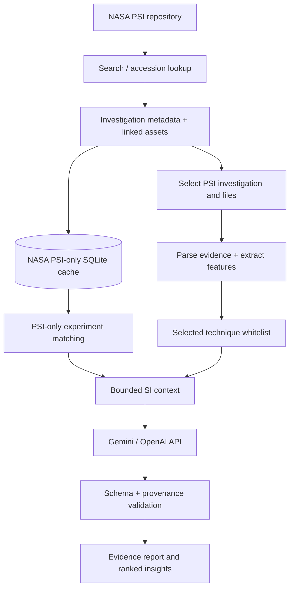

<div align="center">

# 🔥 PyroSage
### Microgravity Fire Intelligence

**A technique-bounded, multimodal research dashboard that helps discover, compare, and interpret microgravity combustion evidence for safer human space exploration.**

[](https://python.org/) [](https://fastapi.tiangolo.com/) [](https://opencv.org/) [](https://psi.nasa.gov/physci/repo) [](#-scientific-methods)

*Read the flame that doesn't rise.*

**[Technical Documentation](docs/PyroSage_Technical_Documentation.pdf) · [NASA PSI Connector Notes](docs/NASA_PSI_CONNECTOR.md)**

</div>

---

## 🌌 Problem statement

For decades, NASA has studied how flames and fire behave in microgravity, gathering a trove of experimental data. That knowledge is increasingly important as humans return to the Moon and travel toward Mars, yet the volume of results makes them difficult to find, compare, and understand. The challenge is to create an interactive, super-intelligence (SI)-powered dashboard that summarizes, ranks, and interprets those findings to deliver fire-safety insights for human space exploration.

## 🚀 What PyroSage does

PyroSage combines research discovery, evidence intake, scientific technique selection, local feature extraction, experiment matching, and API-backed interpretation in one workflow.

1. Explore hypothetical scenarios in a separate Fiction Combustion workspace.
2. Search the official NASA Physical Sciences Informatics (PSI) repository for combustion/fire investigations.
3. Upload images, videos, numerical tables, spectra, and experiment documents.
4. Select relevant scientific techniques and inspect their data prerequisites.
5. Extract supported visual/numerical descriptors and provide bounded evidence context to Gemini or OpenAI.
6. Review structured findings, candidate experiments, rankings, safety insights, and data gaps.

PyroSage uses existing model APIs as its SI reasoning layer. It constrains model requests with a scientific technique registry, selected-method context, NASA PSI candidate IDs, structured output, and backend validation.

## ✨ Feature overview

| Area | Capability |
|---|---|
| Dashboard | Five workspaces; responsive UI; Fiction Combustion preserved separately |
| Evidence intake | Images, video, CSV/TSV, JSON, PDF, DOCX, XLSX |
| Scientific methods | 57 registered techniques with IDs, modalities, prerequisites, and descriptions |
| Local analysis | OpenCV/NumPy image and video descriptors; numeric and document parsing |
| SI engine | Gemini and OpenAI API paths with technique-bounded structured analysis |
| NASA discovery | Official PSI website search, investigation parsing, direct accession lookup |
| Experiment catalogue | SQLite cache with NASA PSI provenance enforcement |
| Reports | Technique assessments, descriptors, experiment matches, ranked findings, JSON export |
| Engineering | Windows/Unix launch scripts, pytest suite, GitHub Actions workflow |

## 🏗️ Architecture



| Layer | Stack |
|---|---|
| Frontend | HTML, CSS, JavaScript, SVG |
| Backend | Python, FastAPI, Uvicorn |
| Vision / numerics | OpenCV, NumPy, SciPy |
| Documents | PyMuPDF, pypdf, python-docx, openpyxl |
| NASA connector | HTTPX, BeautifulSoup |
| Storage | SQLite |
| Intelligence | Gemini API / OpenAI Responses API |
| Tests / CI | pytest / GitHub Actions |

## 🔬 Scientific methods

The 57-entry registry is organized into nine scientific families:

- **Microgravity fundamentals:** buoyancy absence, diffusion-dominated transport, Marangoni flow, spherical symmetry, cool flames, gravity comparison.
- **Geometry and vision:** segmentation, bilateral/top-bottom/rotational symmetry, IoU, convexity, fractal dimension, boundary roughness, centroid features, object classification.
- **Temporal dynamics:** frame variation, symmetry variance, centroid jitter, flicker, extinction/reignition screening.
- **Diagnostics:** Schlieren, shadowgraph, PIV, infrared thermography, FLIR and temperature/flow interpretation.
- **Spectroscopy and chemistry:** LIF, FTIR, Raman, spectral processing, species interpretation, CO/soot precursors, chemical kinetics.
- **Platforms:** drop towers, parabolic flights, sounding rockets, ISS/CIR, orbital capsules and satellites.
- **Gravity scaling:** 0g, 1g, lunar and Martian gravity, partial-gravity comparison.
- **AI methods:** CNN/ResNet classification, differentiable symmetry loss/IoU, temporal and spectral ML.
- **Safety interpretation:** cross-experiment comparison, evidence ranking, anomaly and risk screening, evidence-linked insights.

Every technique record defines an ID, group, description, supported modalities, and prerequisites. The selected techniques define the allowed method set for an SI run.

## 🛰️ NASA PSI data source

The strict experiment-identification workflow uses the official NASA PSI repository:

- Repository: https://psi.nasa.gov/physci/repo
- Search: https://psi.nasa.gov/physci/repo/search?q=combustion&data_source=psi&data_type=investigation
- Example records: [PSI-98](https://psi.nasa.gov/physci/repo/data/investigations/PSI-98), [PSI-107](https://psi.nasa.gov/physci/repo/data/investigations/PSI-107), [PSI-25](https://psi.nasa.gov/physci/repo/data/investigations/PSI-25)

The connector parses the official PSI search and investigation pages and validates assets against the selected investigation. PSI search does not require a NASA developer key; the Gemini/OpenAI key is separate. NASA PSI provenance is retained in the cache and matching workflow. See [connector documentation](docs/NASA_PSI_CONNECTOR.md).

## ⚡ Quick start

```bash
git clone https://github.com/realahmad07/NASA.git
cd NASA
python -m venv .venv
# Windows: .venv\Scripts\Activate.ps1
# macOS/Linux: source .venv/bin/activate
pip install -r requirements.txt
```

Copy `.env.example` to `.env` and add your model key:

```env
PYROSAGE_DEFAULT_PROVIDER=gemini
PYROSAGE_DEFAULT_MODEL=gemini-3.8-flash
GEMINI_API_KEY=your_key_here
OPENAI_API_KEY=
NASA_PSI_BASE_URL=https://psi.nasa.gov
PORT=8000
```

Run `start_windows.bat` on Windows, `./start_unix.sh` on macOS/Linux, or start manually with:

```bash
uvicorn server:app --host 127.0.0.1 --port 8000
```

Open http://127.0.0.1:8000.

## 🧪 Tests and API

Run tests with `python -m pytest -q`. GitHub Actions validates the suite on Python 3.10, 3.11, and 3.12.

| Route | Purpose |
|---|---|
| `GET /api/health` | Health and provider configuration |
| `GET /api/techniques` | Scientific registry |
| `GET /api/nasa-psi/search` | Search official PSI investigations |
| `POST /api/nasa-psi/sync` | Cache selected PSI metadata |
| `GET /api/nasa-psi/experiments` | List cached PSI records |
| `POST /api/nasa-psi/analyze` | Analyze selected PSI evidence |
| `POST /api/analyze` | Analyze uploaded evidence |
| `GET /api/report/{id}` | Retrieve a report |

## 🗺️ Roadmap

Expand NASA PSI coverage and sync resilience; add assisted segmentation and calibrated temporal metrics; implement radiometric thermal analysis and calibrated PIV; develop instrument-aware LIF/FTIR/Raman pipelines; connect validated combustion chemistry and gravity-scaling models; add expert review, reproducible workspaces, and collaborative annotation.

## 🎤 Hackathon demo

1. Explain the challenge of searching and comparing heterogeneous microgravity fire evidence.
2. Show the separate Fiction Combustion simulator.
3. Search NASA PSI and open an investigation.
4. Select evidence and relevant methods from the 57-technique matrix.
5. Run the SI workflow and inspect descriptors, candidate matches, and findings.
6. Present rankings, NASA provenance, safety interpretation, and the lunar/Martian roadmap.

## 📚 References

- [NASA Physical Sciences Informatics](https://psi.nasa.gov/physci/repo)
- [NASA PSI Researcher Guide](https://www.nasa.gov/science-research/for-researchers/researchers-guide-to-physical-sciences-informatics-system/)
- [Gemini API](https://ai.google.dev/gemini-api/docs)
- [OpenAI Responses API](https://developers.openai.com/api/reference/responses/overview)
- [FastAPI](https://fastapi.tiangolo.com/) · [OpenCV](https://docs.opencv.org/)

---

<div align="center"><strong>🔥 PyroSage — Read the flame that doesn't rise.</strong><br><em>Research decision support for microgravity combustion and human space exploration.</em></div>
