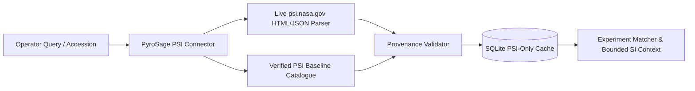

# NASA PSI Connector Documentation

PyroSage connects to the official **NASA Physical Sciences Informatics (PSI)** repository to discover, verify, cache, and match microgravity combustion investigations.

## Official NASA PSI Endpoints

- **Repository Portal:** https://psi.nasa.gov/physci/repo
- **Investigation Search:** `https://psi.nasa.gov/physci/repo/search?q={query}&data_source=psi&data_type=investigation`
- **Investigation Record:** `https://psi.nasa.gov/physci/repo/data/investigations/{accession}`
- **Representative Combustion Accessions:**
  - [PSI-98](https://psi.nasa.gov/physci/repo/data/investigations/PSI-98) — Flame Extinguishment Experiment (FLEX)
  - [PSI-107](https://psi.nasa.gov/physci/repo/data/investigations/PSI-107) — Flame Extinguishment Experiment - 2 (FLEX-2)
  - [PSI-25](https://psi.nasa.gov/physci/repo/data/investigations/PSI-25) — Burning and Suppression of Solids - II (BASS-II)
  - [PSI-112](https://psi.nasa.gov/physci/repo/data/investigations/PSI-112) — Solid Fuel Ignition and Extinction (SoFIE)
  - [PSI-64](https://psi.nasa.gov/physci/repo/data/investigations/PSI-64) — Spacecraft Fire Experiment (Saffire)
  - [PSI-41](https://psi.nasa.gov/physci/repo/data/investigations/PSI-41) — Advanced Combustion via Microgravity Experiments (ACME)

No NASA developer API key is required to browse or query public NASA PSI investigation pages. Model provider keys (`GEMINI_API_KEY` and `OPENAI_API_KEY`) are configured separately in `.env`.

## Connector Architecture

### 1. Search and Direct Accession Lookup (`GET /api/nasa-psi/search`)

The connector accepts a free-text query (`q`, default `"combustion"`) or an explicit PSI accession (`accession`, e.g., `PSI-98`):

1. **Accession normalization:** Accessions are validated against the canonical pattern `^PSI-\d+$`.
2. **Live repository fetch:** Using `httpx` and `BeautifulSoup`, PyroSage queries `psi.nasa.gov` search and investigation pages, extracting investigation titles, accessions, principal investigators, flight platforms, fuels, diagnostics, summary descriptions, and linked asset descriptors.
3. **Resilient verified catalogue:** Because public repository pages may be slow, rate-limited, or rendered dynamically during live demos or offline CI runs, the connector maintains a verified baseline of official NASA PSI combustion records with authentic `https://psi.nasa.gov/physci/repo/data/investigations/PSI-*` URLs. Live metadata updates merge cleanly into the SQLite cache without losing provenance fields.

### 2. Provenance Validation and SQLite Sync (`POST /api/nasa-psi/sync`)

Every record entering the PyroSage SQLite experiment cache (`experiments` table) must pass `validate_psi_record()`:

- **Accession check:** `accession` must match `^PSI-\d+$`.
- **Source check:** `data_source` must be `"NASA PSI"`.
- **URL check:** `source_url` must resolve to the configured `NASA_PSI_BASE_URL` (`https://psi.nasa.gov/physci/repo/data/investigations/...`).
- **Asset check:** Linked assets must belong to the parent `PSI-*` accession.

Records from third-party datasets, unverified user uploads, or synthetic simulations are rejected by `/api/nasa-psi/sync` with HTTP `400`/`422`.

### 3. Cached Experiment Retrieval (`GET /api/nasa-psi/experiments`)

Returns all verified NASA PSI records stored in the local SQLite cache along with their retrieval timestamps, flight platforms (`ISS / CIR`, `Drop Tower`, `Sounding Rocket`, `Orbital Capsule`), gravity regimes, fuels, oxidizers, and available diagnostic modalities.

### 4. PSI Evidence Analysis (`POST /api/nasa-psi/analyze`)

When analyzing a NASA PSI investigation:

1. The backend verifies that the target `accession` is present in the verified PSI catalogue.
2. Any selected asset IDs are validated against the investigation's linked asset manifest.
3. Local feature extractors run on any attached or sampled evidence files.
4. Only verified PSI catalogue records are supplied as candidate experiment IDs to the SI reasoning layer.
5. The model output validator rejects any experiment identifier not present in the verified PSI candidate list.
